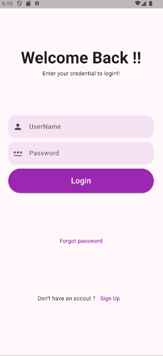
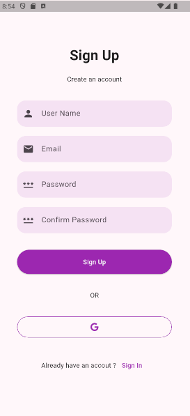

# TP6 – Interfaces de Connexion et d'Inscription en Flutter

Application Flutter composée de deux écrans, **Login** et **Sign Up**, avec une navigation entre les deux pages.

## Captures d'écran

| Connexion (Login) | Inscription (Sign Up) |
| :---: | :---: |
|  |  |

## Fonctionnalités

### Page de connexion – `lib/login/login.dart`
- En-tête « Welcome Back !! » avec un message d'accueil (`_header()`)
- Champs `TextField` pour le nom d'utilisateur et le mot de passe, séparés par un `SizedBox` (`_inputField()`)
- Bouton `ElevatedButton` « Login » de forme arrondie (`StadiumBorder`)
- Lien `TextButton` « Forgot password » (`_forgetPassword()`)
- Lien « Sign Up » vers la page d'inscription (`_signUp(context)`)

### Page d'inscription – `lib/login/signup.dart`
- Hauteur adaptée à l'écran avec `MediaQuery.of(context).size.height - 50` dans un `SingleChildScrollView`
- 4 champs `TextField` : User Name, Email, Password, Confirm Password
- Bouton `ElevatedButton` « Sign Up »
- Séparateur « OR »
- Bouton de connexion Google : `Container` avec bordure violette arrondie (`BoxDecoration`) et icône `FontAwesomeIcons.google`
- Lien « Sign In » pour revenir à la page de connexion

### Navigation
- **Login → Sign Up** : `Navigator.push(context, MaterialPageRoute(builder: (context) => SignUpPage()))`
- **Sign Up → Login** : `Navigator.pop(context)`

## Structure du projet

```
lib/
├── main.dart          # Point d'entrée, thème violet (ColorScheme.fromSeed)
└── login/
    ├── login.dart     # LoginPage
    └── signup.dart    # SignUpPage
assets/
├── screen1.png        # Capture de la page d'inscription
└── screen2.png        # Capture de la page de connexion
```

## Technologies

- Flutter / Dart (SDK ^3.8.1)
- Material Design
- [font_awesome_flutter](https://pub.dev/packages/font_awesome_flutter) pour l'icône Google

## Lancer le projet

```bash
git clone <url-du-depot>
cd firebase_login
flutter pub get
flutter run
```

## Auteur

**Salma Ben Chaouacha**
