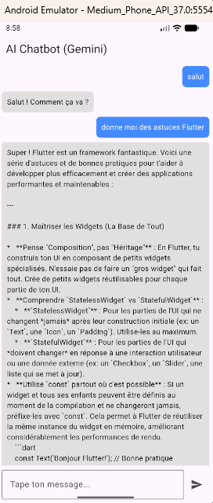

# 🤖 AI Chatbot (Gemini) – Flutter

Application mobile Flutter de chatbot connectée à l'API **Google Gemini**, réalisée dans le cadre du **TP 9 – Développement mobile** (ISSAT, 3ème année ingénieur, groupe 2).

<p align="center">
  
</p>

## ✨ Fonctionnalités

- 💬 Conversation utilisateur / chatbot affichée sous forme de **bulles** (utilisateur à droite en bleu, bot à gauche en gris)
- 🌐 Envoi des questions à l'API **Gemini** (`generateContent`) via une requête HTTP POST au format JSON
- ⏳ Indicateur **« Le bot écrit… »** pendant l'attente de la réponse (`_isLoading`)
- 🔁 Nouvel essai automatique quand le modèle est surchargé (erreur 503)
- 🛡️ Lecture défensive de la réponse JSON (`candidates → content → parts → text`) et gestion des erreurs réseau

## 🛠️ Technologies

- **Flutter / Dart** (Material 3, `StatefulWidget`, `setState`)
- Package [`http`](https://pub.dev/packages/http) pour les appels REST
- `dart:convert` (`jsonEncode` / `jsonDecode`)
- **Google Gemini API** – modèle `gemini-2.5-flash`

## 📁 Structure

```
lib/
├── main.dart                   # Point d'entrée (MaterialApp → ChatScreen)
├── secrets.dart                # Lit la clé API depuis env.json
└── views/chat/
    └── chat_screen.dart        # Interface du chat + appel à Gemini
assets/
└── chatbot_screenshot.png
env.example.json                # Modèle du fichier de clé (env.json, non versionné)
```

## 🚀 Lancer le projet

1. Cloner le dépôt puis installer les dépendances :
   ```bash
   flutter pub get
   ```
2. Créer une clé API sur [Google AI Studio](https://aistudio.google.com/), copier `env.example.json` en `env.json` et y coller la clé :
   ```json
   { "GEMINI_API_KEY": "VOTRE_CLE_API_ICI" }
   ```
   > `env.json` est ignoré par Git : la clé n'est jamais publiée. `lib/secrets.dart` la lit avec `String.fromEnvironment`.
3. Lancer l'application sur un émulateur ou un appareil :
   ```bash
   flutter run --dart-define-from-file=env.json
   ```

## ⚙️ Fonctionnement

1. L'utilisateur saisit un message → il est ajouté à la liste `messages` et `_isLoading` passe à `true`.
2. `getChatbotResponse()` envoie le texte à l'endpoint
   `https://generativelanguage.googleapis.com/v1beta/models/gemini-2.5-flash:generateContent`.
3. La réponse JSON est décodée, le texte généré est ajouté comme message du bot et `_isLoading` repasse à `false`.

